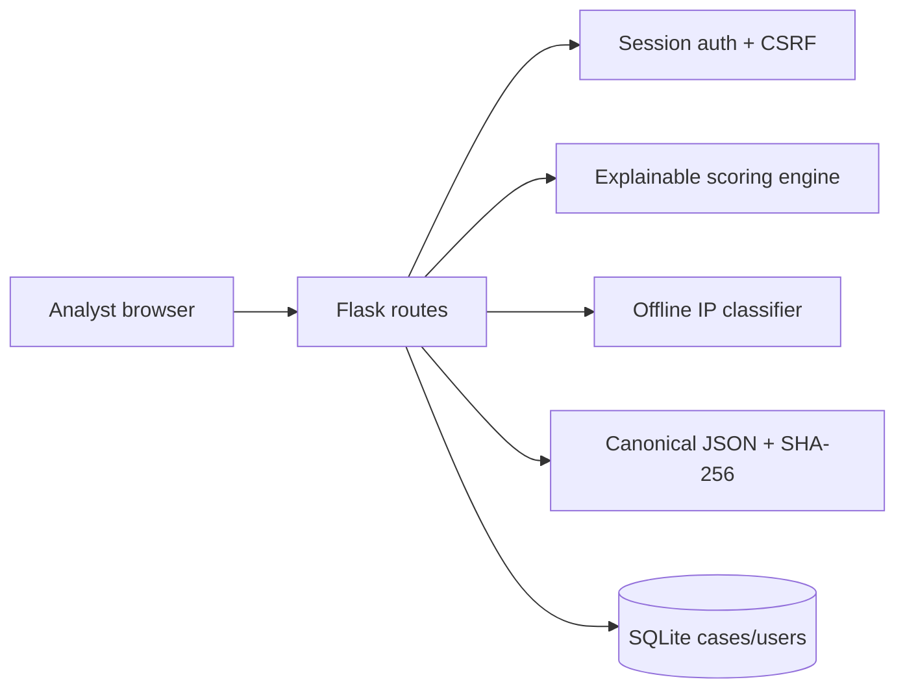
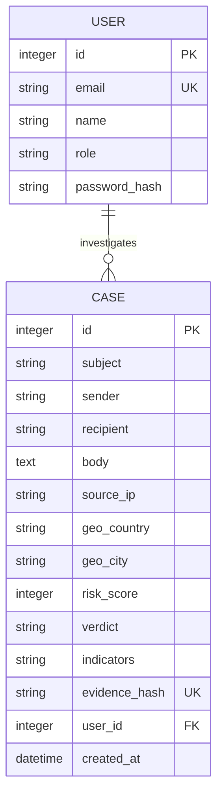

# SentinelMail

**AI-powered email threat detection, geolocation and forensic intelligence platform** for the AICTE Smart India Hackathon cybersecurity track.

## Problem
Security teams receive phishing, business-email-compromise and payment-lure messages faster than they can manually triage them. Existing mail filters often provide a binary decision without explainability, location context, or evidence integrity. SentinelMail gives an analyst one workspace to score a message, understand the signals, classify its source IP, and prove that the captured evidence was not altered.

## Solution and innovation
- Explainable, weighted threat scoring instead of an opaque label.
- Offline-first IP classification that works in a live demo and can be replaced by a licensed GeoIP provider.
- SHA-256 evidence anchoring and verification for a simple forensic chain of custody.
- A human-in-the-loop review queue: the system prioritizes decisions; analysts remain accountable.
- Privacy-first processing: raw message content stays in the local SQLite database.

The MVP deliberately does not claim a trained AI model or a public blockchain network. The current engine is a deterministic, auditable baseline; a production release can add a calibrated classifier and permissioned anchoring after collecting consented labelled data.

## Research basis
The design addresses common BEC and phishing patterns reported in FBI Internet Crime Complaint Center guidance, uses sender-authentication concepts from SPF/DKIM/DMARC, and maps future detection rules to MITRE ATT&CK phishing techniques. It complements, rather than replaces, organisational controls such as CERT-In incident reporting, secure email gateways, and DMARC enforcement. The key gap is an analyst-facing, evidence-aware explanation layer combining these signals in one low-cost tool.

## Features
**MVP:** hashed authentication, email analysis, weighted indicators, risk verdict, online GeoIP enrichment with offline fallback, IP validation/classification, case history, case detail, evidence hash verification, responsive dashboard, SQLite persistence, tests.

**Advanced:** RFC 822/.eml upload, live MaxMind GeoLite2 enrichment, SPF/DKIM/DMARC parsing, URL reputation connectors, role-based admin review, calibrated ML model, and permissioned blockchain anchoring.

**Future:** organisation-wide tenant isolation, streaming mailbox connectors, graph-based campaign clustering, multilingual phishing analysis, analyst feedback loop, and SIEM/SOAR integrations.

## Architecture




## Folder structure
```text
SIH/
├── app.py                 # App factory, schema creation and demo seed
├── config.py              # Environment-backed Flask config
├── extensions.py          # SQLAlchemy instance
├── models.py              # User and Case entities
├── security.py            # Session CSRF token protection
├── requirements.txt
├── .env.example
├── routes/
│   ├── auth.py            # Login, registration and logout
│   └── main.py            # Dashboard, cases and analysis API
├── services/
│   ├── analyzer.py        # Explainable scoring rules
│   ├── geo.py             # Safe offline IP classification
│   └── evidence.py        # Canonical payload hashing and verification
├── templates/             # Responsive Jinja screens
├── static/                # CSS and progressive enhancement JS
├── tests/                 # Service and Flask integration tests
└── docs/                  # SIH slides, demo and viva pack
```

## Run on Windows
```powershell
cd C:\path\to\SIH
py -m venv .venv
.\.venv\Scripts\Activate.ps1
python -m pip install -r requirements.txt
Copy-Item .env.example .env
python app.py
```
Open `http://127.0.0.1:5000`. Demo login: `analyst@sih.local` / `Demo@12345`.

Run tests:
```powershell
python -m pytest -q
```

## API
`POST /api/analyze` requires an authenticated session and `X-CSRF-Token` header. Form or JSON fields: `subject`, `sender`, `recipient`, `body`, optional `headers`, `source_ip`. Returns `id`, `score`, `verdict`, `level`, `indicators`, `location`, and `evidence_hash`. Missing required fields return HTTP 400.

## Online and offline location modes
Public IPs use the configured online GeoIP provider when internet access is available. If the provider times out, returns invalid data, or `GEOIP_LOOKUP=off` is set, analysis continues with the offline classification and the location source is labeled accordingly. Optional settings are `GEOIP_LOOKUP` (`auto` by default), `GEOIP_TIMEOUT` (2 seconds by default), and `GEOIP_LOOKUP_URL` (defaults to `https://ipapi.co/{ip}/json/`).

## Security and limitations
Passwords use Werkzeug PBKDF2 hashing. SQLAlchemy parameterizes database operations. State-changing analysis uses a session-backed CSRF token. Jinja escapes rendered content. Use a random `SECRET_KEY`, HTTPS, secure cookie flags, rate limiting, production database, and an external secret manager before deployment. The offline geo service is intentionally a fallback and must not be presented as authoritative geolocation.

## Deployment
For a student demo, use Render with a Python web service and a persistent disk, or run the same Gunicorn-compatible Flask app on a low-cost VM. Set `SECRET_KEY`, `DATABASE_URL`, and `PORT` as environment variables. SQLite is suitable for the demo; PostgreSQL is the production migration target. A reverse proxy should terminate TLS. Never commit `.env` or `instance/*.db`.

Docker locally:
```powershell
Copy-Item .env.example .env
docker compose up --build
```
Then open `http://127.0.0.1:8000`. The container runs as a non-root user and persists the SQLite volume under `sentinelmail-data`.

## Testing and audit
The tests cover safe/malicious classification, deterministic hashing, private/invalid IPs, authenticated analysis, validation errors, unauthenticated access, and template-backed dashboard flow. A final audit should include desktop/mobile browser checks, malformed input, CSRF rejection, password policy, database backup/restore, and deployment secrets.
